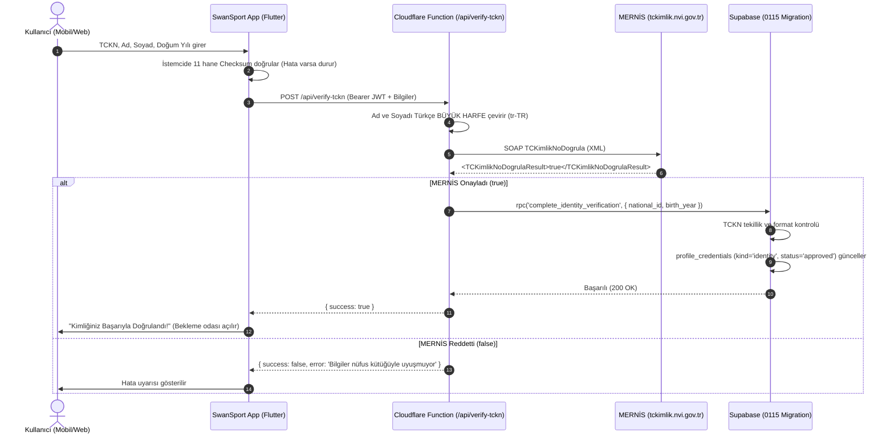

# SwanSport — Otomatik MERNİS (NVİ) T.C. Kimlik Doğrulama Şartnamesi (Codex Blueprint)

**Tarih:** 2026-10-14
**Kapsam:** Türkiye Cumhuriyeti Nüfus ve Vatandaşlık İşleri (NVİ) MERNİS SOAP servisi ile gerçek zamanlı, güvenli ve KVKK uyumlu T.C. Kimlik Numarası (TCKN) doğrulaması.

---

## 1. Mimari Prensipler ve Değişmezler (Invariants)

1. **KVKK ve Veri Gizliliği (`AGENTS.md` & `0100` Sözleşmesi):**
   - TCKN **asla** genel profil sorgularında (`profiles.select('*')`), hakem esamesinde, antrenör listesinde veya arama sonuçlarında açık metin olarak dönmez.
   - Doğrulama sonrası dış dünyaya yalnızca `identity_verified: true` ve `verificationTier: 'id'` döner.
   - **Tekillik Kuralı:** 1 TCKN yalnızca 1 profile bağlanabilir. Aynı TCKN ile mükerrer hesap açılamaz.
2. **NVİ / MERNİS SOAP Kuralı:**
   - Ad ve Soyad kesinlikle **Türkçe büyük harf** (`toLocaleUpperCase('tr-TR')`) ile gönderilmelidir. ("İ" / "I" karakter hatası NVİ'de doğrudan ret üretir).
   - Servis adresi: `https://tckimlik.nvi.gov.tr/Service/KPSPublic.asmx`
   - Doğrudan mobil istemciden çağrılamaz (CORS ve IP engeli); Cloudflare Pages Function proxy (`/api/verify-tckn`) üzerinden yürütülür.
3. **Klavye ve İstemci Koruması (Algoritmik Checksum):**
   - İstemci (Flutter) tarafında 11 hane checksum formülü çalışır. Hatalı numara girildiğinde sunucuya veya devlete gereksiz istek atılmaz.
4. **Rate Limiting (Brute-Force Koruması):**
   - Aynı IP veya oturumdan dakikada en fazla 5 MERNİS doğrulama denemesine izin verilir.

---

## 2. Sistem Mimarisi ve Veri Akışı



---

## 3. Uygulama Adımları ve Oluşturulacak Dosyalar

### A. Veritabanı Temeli (`supabase/migrations/0115_automated_identity_verification.sql`)
1. **İşlem Güvenliği:** İlk satırda `set local lock_timeout = '15s';`.
2. **RPC: `public.complete_identity_verification(p_national_id text, p_birth_year int)`**:
   - `language plpgsql security definer set search_path = public`
   - Giriş kontrolü: `auth.uid() is not null`.
   - Format kontrolü: `p_national_id ~ '^[1-9][0-9]{10}$'`.
   - Tekillik kontrolü: `if exists (select 1 from public.profile_credentials where verified_national_id = p_national_id and profile_id <> auth.uid() and status = 'approved') then raise exception 'Bu T.C. Kimlik Numarası başka bir hesapta onaylı'; end if;`
   - Eğer kullanıcının zaten onaylı bir `verified_national_id`'si varsa ve farklıysa değiştirilemez (`Doğrulanmış TCKN değiştirilemez`).
   - `profile_credentials` içine `kind = 'identity'`, `status = 'approved'`, `verified_national_id = p_national_id`, `reviewed_at = clock_timestamp()` satırı eklenir veya güncellenir.
   - Doğum tarihi güncellemesi: Eğer sporcu veya profilde doğum yılı eksikse `(p_birth_year || '-01-01')::date` olarak güncellenir.
   - Audit kaydı eklenir.

---

### B. Cloudflare Function: MERNİS SOAP Entegrasyonu (`apps/swansport_app/functions/api/verify-tckn.js`)
1. **Giriş Parametreleri:** `national_id`, `first_name`, `last_name`, `birth_year`.
2. **Türkçe Büyük Harf Dönüştürme:**
   ```javascript
   function toTurkishUpper(str) {
     return str
       .replace(/i/g, 'İ')
       .replace(/ı/g, 'I')
       .toLocaleUpperCase('tr-TR')
       .trim();
   }
   ```
3. **NVİ SOAP İsteği:**
   ```javascript
   const soapEnvelope = `<?xml version="1.0" encoding="utf-8"?>
   <soap12:Envelope xmlns:xsi="http://www.w3.org/2001/XMLSchema-instance" xmlns:xsd="http://www.w3.org/2001/XMLSchema" xmlns:soap12="http://www.w3.org/2003/05/soap-envelope">
     <soap12:Body>
       <TCKimlikNoDogrula xmlns="http://tckimlik.nvi.gov.tr/WS">
         <TCKimlikNo>${nationalId}</TCKimlikNo>
         <Ad>${cleanFirstName}</Ad>
         <Soyad>${cleanLastName}</Soyad>
         <DogumYili>${birthYear}</DogumYili>
       </TCKimlikNoDogrula>
     </soap12:Body>
   </soap12:Envelope>`;

   const nviResponse = await fetch('https://tckimlik.nvi.gov.tr/Service/KPSPublic.asmx', {
     method: 'POST',
     headers: {
       'Content-Type': 'application/soap+xml; charset=utf-8',
     },
     body: soapEnvelope,
   });
   ```
4. **Yanıt Ayrıştırma:**
   - XML içeriğinde `<TCKimlikNoDogrulaResult>true</TCKimlikNoDogrulaResult>` var mı kontrol edilir.
5. **Supabase Tamamlama:**
   - `true` ise Authorization başlığındaki Bearer token ile Supabase RPC `complete_identity_verification` çağrılır.
   - `{ success: true }` döndürülür.

---

### C. Ortak Veri Katmanı (`packages/swansport_data`)
1. **`verification_service.dart` Genişletmesi:**
   - `Future<({bool success, String? error})> verifyWithMernis({required String nationalId, required String firstName, required String lastName, required int birthYear})`
   - Fonksiyon `apps/swansport_app/functions/api/verify-tckn` adresine POST isteği gönderir.
   - Başarılı olursa `myIdentityGateProvider` ve `myCredentialsProvider` invalidate edilir; `SwanAccess.hasVerifiedIdentity` otomatik `true` olur.

---

### D. Mobil Ekran Entegrasyonu (`apps/swansport_app`)
1. **`credential_screen.dart` (Kimlik Doğrulama Ekranı):**
   - Kimlik sekmesinde mevcut "Belge Fotoğrafı Yükle" seçeneğinin üzerine **"MERNİS ile Anında T.C. Kimlik Doğrula"** kartı eklenir.
   - Alanlar:
     * T.C. Kimlik No (11 hane, rakam klavyesi).
     * Ad (Kimlikte yazan tam ad).
     * Soyad.
     * Doğum Yılı (örn: 1995).
   - "Doğrula ve Onayla" butonu.
   - Başarı durumunda: Yeşil rozet *"Kimliğiniz MERNİS üzerinden başarıyla doğrulandı."* uyarısı çıkar ve kullanıcı bekleme odasından kurtulur.

---

## 4. Test ve Doğrulama Adımları

1. **SQL Testi:** `tools/mernis_identity_sql_test.mjs` (0115 migration, TCKN regex kontrolü, tekillik ve yetki testi).
2. **MERNİS SOAP Testi:** Cloudflare Worker üzerinden mock ve canlı XML ayrıştırma testi.
3. `python tools/check_migrations.py`: 115 migration hatasız geçmeli.
4. `python tools/check_faq.py` ve `python tools/check_push_routes.py`: Senkronize kalmalı.
5. `git diff --check`: Boşluk/satır sonu hatasız olmalı.
