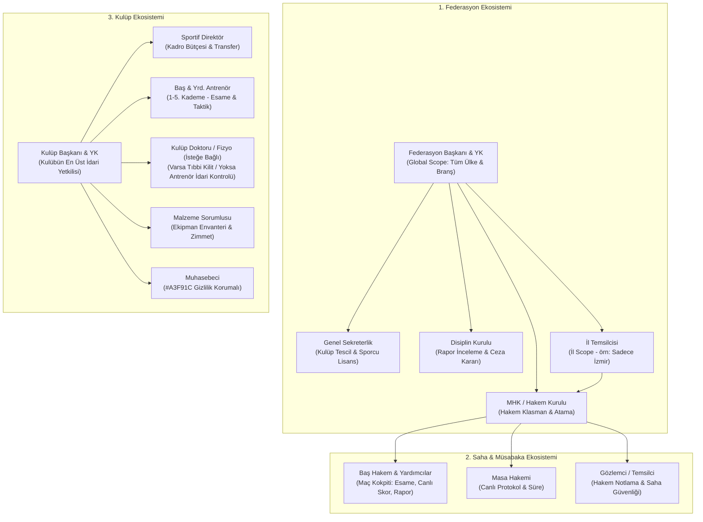

# SwanSport — Gerçek Hayat Spor Rolleri & Federasyon Hiyerarşisi Uygulama Planı (Codex Blueprint)

**Tarih:** 2026-10-13
**Sürüm:** v1.0.0
**Kapsam:** Federasyon, İl Temsilciliği, MHK, Hakemler, Saha Görevlileri ve Kulüp İçi İhtisas Rolleri Hiyerarşik Mimarisi
**Mühendislik İlkesi:** Sıralı, idempotent, geriye dönük uyumlu, test edilebilir 5 uygulama fazı.

---

## 1. Mimari Prensipler ve Değişmezler (Invariants)

1. **Üst Rol Alt Rolü Kapsar (Inherited Scoped RBAC):**
   - **Federasyon Başkanı:** `city_code IS NULL` (Global Scope). Tüm illeri, kurulları (MHK, Disiplin, Tescil) ve ligleri kapsar; denetleme ve gerektiğinde iptal/onay hakkına sahiptir.
   - **İl Temsilcisi:** Belirli bir ile bağlıdır (`city_code = '35'` gibi). Yalnızca kendi ilindeki kulüpleri, ligleri ve yerel fikstürü yönetir.
   - **MHK:** Hakem kadrolarını yönetir ve maçlara hakem atar.
   - **Hakem:** Yalnızca kendisine atanan maçın (`match_id`) kokpitine girip esame onayı ve canlı skor girebilir.
2. **Doktor Esnekliği (Amatör Kulüp vs. Profesyonel Kulüp Kuralı):**
   - Kulüpte kadrolu doktor/fizyoterapist bulunması **zorunlu değildir**.
   - **Doktorsuz Kulüp:** Antrenör veya Kulüp Yöneticisi idari olarak sporcuyu *"Sakat / Dinlendiriliyor"* olarak işaretleyebilir ve istediğinde tekrar kadroya alabilir. Sistem asla kilitlenmez.
   - **Doktorlu Kulüp (`can_verify_medical` açık):** Sağlık görevlisi kısıt koyduğunda **Tıbbi Zorunlu Kilit (Medical Hard Lock)** devreye girer; antrenör veya kulüp başkanı bu kilidi tek taraflı kaldıramaz.
   - **Resmi Maçlar:** Federasyon lisans vizesi devlet/aile hekimliği onaylı resmi sağlık raporuna bakar; kulüp doktoruna bağımlı değildir.
3. **Mevcut Güvenlik Sözleşmelerinin Korunması:**
   - **Muhasebeci Anonimliği:** `club_accountants` sporcu adlarını asla göremez; `#A3F91C` kimlik kodu kuralı bozulamaz.
   - **Çocuk Gizliliği:** Reşit olmayan sporcularda veli onayı olmadan dış görünürlük açılamaz.
   - **İşlem Güvenliği:** Hakem maçı imzalayıp kapattığında `result_version` kilitlenir; doğrudan müdahale engellenir.

---

## 2. Sistem Şeması & Akış Diyagramı

---

## 3. Uygulama Fazları (Codex Engineering Execution)

### 🟢 FAZ 1: Veritabanı ve Şema Temeli (0110 Migration & Scoped RLS)
* **Hedef:** Gerçek hayat rollerini, hakem kadrolarını, maç atamalarını ve kulüp ihtisas rollerini veritabanında modellemek.
* **SQL Migration (`0110_sports_role_hierarchy.sql`):**
  1. `federation_roles`:
     - `id uuid primary key default gen_random_uuid()`
     - `federation_id uuid not null references public.federations(id)`
     - `profile_id uuid not null references public.profiles(id)`
     - `role text not null check(role in ('president','board_member','general_secretary','provincial_rep','referee_committee','disciplinary_board'))`
     - `city_code text references public.cities(code)` (Yalnızca `provincial_rep` için zorunlu, başkan için `null`)
     - `starts_on date not null`, `ends_on date not null`, `revoked_at timestamptz`
  2. `referee_profiles`:
     - `id uuid primary key default gen_random_uuid()`
     - `profile_id uuid not null unique references public.profiles(id)`
     - `license_number text not null unique`
     - `badge_tier text not null check(badge_tier in ('candidate','provincial','national','international'))`
     - `sport_code text not null references public.sports(code)`
     - `city_code text not null references public.cities(code)`
     - `is_active boolean not null default true`
  3. `match_officials`:
     - `id uuid primary key default gen_random_uuid()`
     - `match_id uuid not null references public.org_matches(id) on delete cascade`
     - `profile_id uuid not null references public.profiles(id)`
     - `duty text not null check(duty in ('head_referee','assistant_referee_1','assistant_referee_2','fourth_referee','table_official','observer'))`
     - `status text not null default 'assigned' check(status in ('assigned','accepted','declined','replaced'))`
     - `assigned_at timestamptz not null default clock_timestamp()`, `responded_at timestamptz`
     - `unique(match_id, duty)`
  4. `club_staff_roles`:
     - `id uuid primary key default gen_random_uuid()`
     - `club_id uuid not null references public.clubs(id) on delete cascade`
     - `profile_id uuid not null references public.profiles(id)`
     - `role text not null check(role in ('president','sporting_director','doctor','physiotherapist','kit_manager','media_officer'))`
     - `unique(club_id, profile_id, role)`
  5. **Doktor Esnekliği RPC Düzenlemesi:**
     - Kulüpte `is_authorized_health_officer` varsa tıbbi kilit (`health_restrictions`) zorunlu tutulur.
     - Kulüpte sağlık görevlisi yoksa antrenör esamede sporcuyu "dinlendiriliyor" olarak geçici işaretleyebilir (`lineup_administrative_notes`).
* **RLS & Fonksiyonlar:**
  - `referee_my_matches()`: Giriş yapmış hakemin atandığı maçları getirir.
  - `referee_verify_lineup(match_id, participant_id, athlete_ids, notes)`: Hakem esame listesini onaylar.
  - `referee_submit_live_event(match_id, event_type, minute, team_id, athlete_id, payload)`: Canlı skor ve kart girişi.

---

### 🟡 FAZ 2: Ortak Veri Katmanı (`packages/swansport_data` & `SwanAccess`)
* **Hedef:** Tüm istemcilerin (mobil & konsol) tek noktadan yetki sorgulayabileceği Dart modelleri ve Riverpod servislerini kurmak.
* **`SwanAccess` (`packages/swansport_data/lib/src/access.dart`) Genişletmesi:**
  - `final List<FederationRoleEntry> federationRoles;`
  - `final RefereeProfile? refereeProfile;`
  - `final List<ClubStaffRoleEntry> clubStaffRoles;`
  - Metotlar:
    - `bool get isFederationPresident => federationRoles.any((r) => r.role == 'president' && r.isActive);`
    - `bool isProvincialRep(String cityCode) => isFederationPresident || federationRoles.any((r) => r.role == 'provincial_rep' && r.cityCode == cityCode && r.isActive);`
    - `bool get isReferee => refereeProfile != null && refereeProfile!.isActive;`
    - `bool isClubPresident(String clubId) => clubStaffRoles.any((r) => r.clubId == clubId && r.role == 'president');`
    - `bool isClubMedicalStaff(String clubId) => clubStaffRoles.any((r) => r.clubId == clubId && (r.role == 'doctor' || r.role == 'physiotherapist'));`
    - `bool isClubKitManager(String clubId) => clubStaffRoles.any((r) => r.clubId == clubId && r.role == 'kit_manager');`
    - `bool canManageMatch(String matchId, {String? cityCode})`
* **Yeni Sağlayıcılar (Providers):**
  - `myRefereeMatchesProvider`: Hakemin aktif maç atamaları.
  - `matchLineupVerificationProvider`: Esame listesi doğrulama sağlayıcısı.
  - `matchLiveCockpitProvider`: Canlı skor ve olay sağlayıcısı.
  - `clubStaffListProvider`: Kulüp içi görevliler listesi.

---

### 🔴 FAZ 3: Mobil Hakem Kokpiti & Saha Operasyonu (`apps/swansport_app`)
* **Hedef:** Hakemin cep telefonundan resmi maçı baştan sona yönetebilmesi.
* **Ekranlar ve Akış:**
  1. **Hakem Görev Paneli (`/hakem/gorevler`):**
     - Yaklaşan maç atamaları (Tarih, Saat, Saha, Branş, Ev Sahibi, Deplasman).
     - Görev kabul / mazeret bildirme aksiyonu.
  2. **Dijital Esame Onayı (`/hakem/esame-onay/:matchId`):**
     - İki takımın sunduğu sporcu listesi (Forma no, Ad Soyad, Lisans no).
     - Otomatik kontroller: Ceza kuralı (Disiplin cezası var mı?), Sağlık vizesi (Tarihi geçerli mi?), Varsa doktor sakatlık kilidi.
     - Tek tuşla *"Esame Listesini Onayla ve Kilitle"*.
  3. **Canlı Müsabaka Kokpiti (`/hakem/mac-yonetim/:matchId`):**
     - Saha koşullarına uygun, yüksek kontrastlı ve tek elle basılabilir butonlar:
       - Skor Ekle (Futbol: Gol / Basketbol: +1, +2, +3 / Voleybol: Sayı & Set).
       - Kartlar & Fauller (Sarı Kart, Kırmızı Kart, Teknik Faul).
       - Oyuncu Değişikliği (Çıkan / Giren sporcu seçimi).
       - Devre / Periyot / Set Bitişi.
  4. **Resmi Maç Raporu ve İmza (`/hakem/mac-raporu/:matchId`):**
     - Skor, goller ve kartlar otomatik özetlenir.
     - Varsa olay açıklaması ve disiplin sevki kutusu.
     - Hakemin dijital onayı ile sonuç resmi tescil durumuna geçer (`_federation_commit_result`).

---

### 🔵 FAZ 4: Masaüstü Yönetim Konsolu (`apps/swansport_console`)
* **Hedef:** Federasyon, İl Temsilciliği ve MHK'nın ligleri ve hakemleri masaüstünden yönetmesi.
* **Modüller:**
  1. **Federasyon & İl Temsilciliği Modülü (`/federation/leagues`):**
     - İl Temsilcisi: Kendi ilindeki yerel fikstürü, maç saatlerini ve salon tahsislerini düzenler.
     - Federasyon Başkanı: Tüm illerin özet durumunu, lisans hareketlerini ve genel lig tablosunu inceler.
  2. **MHK Hakem Atama Modülü (`/federation/referee-assignments`):**
     - Haftanın maçları takvimde listelenir.
     - Hakem listesi klasman, il ve dinlenme süresine göre filtrelenir; maçlara Başhakem, Yardımcı, Masa Hakemi ve Gözlemci atanır.
  3. **Disiplin Kurulu Modülü (`/federation/discipline`):**
     - Hakem raporundan sevk edilen kırmızı kart ve olaylar otomatik olarak listelenir.
     - Kurul ceza kararını girer (örn: *"2 maç men"*); sporcunun lisansı otomatik kilitlenir.

---

### 🟣 FAZ 5: Kulüp İçi İhtisas Rolleri & Saha Dışı Modüller
* **Hedef:** Kulüp içi rollerin (Doktor, Malzemeci, Sportif Direktör) günlük operasyonlarını kolaylaştırmak.
* **Modüller:**
  1. **Sağlık & Sakatlık Paneli:**
     - Doktor/Fizyo varsa: Tıbbi teşhis/tedavi takvimi ve maç oynama yasağı (Tıbbi Kilit).
     - Doktor yoksa: Antrenörün idari dinlendirme notları.
  2. **Malzeme & Zimmet Modülü:**
     - Kulüp demirbaşları, formalar, toplar ve ekipmanlar.
     - Kime, ne zaman zimmetlendi; ne zaman iade edildi takip ekranı.
  3. **Sportif Direktör Modülü:**
     - Kadro sözleşmeleri, transfer talepleri ve antrenör dönemsel performans karneleri.

---

## 4. Kalite Kapıları ve Doğrulama Kriterleri

Her faz tamamlandığında aşağıdaki kontrollerin **%100 yeşil** geçmesi zorunludur:
1. `python tools/check_migrations.py`: SQL sözdizimi, idempotentlik ve kilit zaman aşımı kontrolü.
2. `python tools/check_faq.py`: Yeni roller ve ekranlar için SSS maddelerinin senkronizasyonu.
3. `python tools/check_push_routes.py`: Hakem atama bildirimleri ve rota derin bağlantıları kontrolü.
4. `python tools/check_mobile_ui_tokens.py`: Yeni ekranlarda SwanType, SwanPalette ve SwanShape jeton uyumu.
5. `melos run analyze`: Dart statik analizi ve tip güvenliği.
